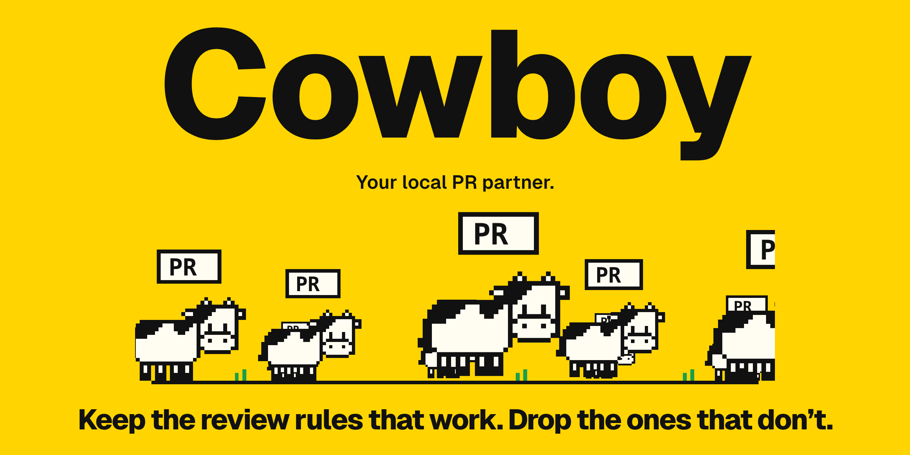
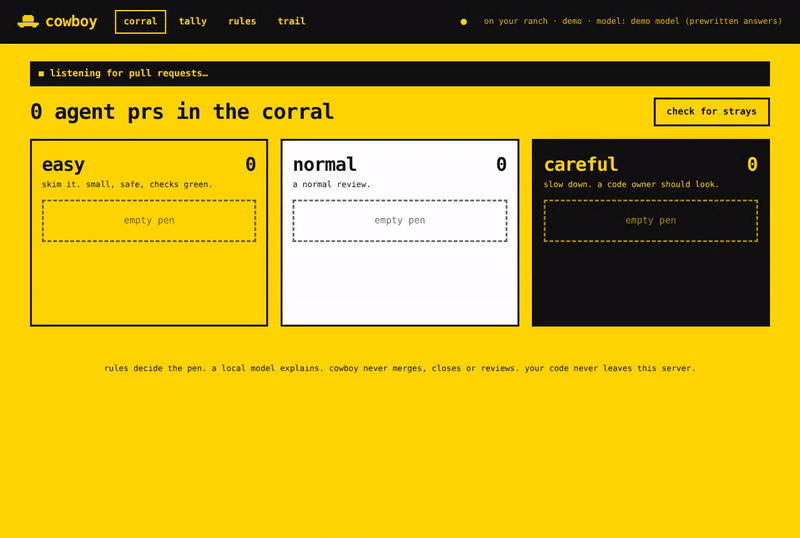

<p align="center">
  
</p>

<p align="center">
  <a href="https://github.com/sgracia13/Cowboy/releases/latest"></a>
  <a href="https://github.com/sgracia13/Cowboy/actions/workflows/ci.yml"></a>
  <a href="LICENSE"></a>
  
  
</p>

<p align="center">
  <b><a href="#try-it-in-one-minute-no-setup">try it in one minute</a></b> ·
  <a href="#try-it-on-your-repo">run it on your repo</a> ·
  <a href="scripts/eval/evidence">the evidence</a>
</p>

# cowboy

every team has review rules: *big prs need two reviewers*, *anything in migrations needs an owner*, *agent work gets a closer look*. some of them catch real problems. some just cost reviewer time. **cowboy tells you which.**

- 🐄 **sorts every pull request as it arrives** into **easy**, **normal** or **careful**, by fixed rules, with the reasons written on the pr. work from claude code, copilot, codex and other agents is tagged.
- 🔎 **watches what happens after merge.** reverts, main breaking, follow-up fixes and incidents, traced back to the pull request that caused them. it can rate your last 90 days on day one.
- ⚖️ **checks which rules earn their place,** against simple alternatives (largest first, most files touched, a random pick), with the counts and a likely range. with too little history, it says so.
- 🧭 **shows your team's habits, and guides your agents.** how often prs here change tests with code, skip shortcuts and get reviewed, and whether each habit went with less trouble *in this repo*. `cowboy guide` turns your rules and habits into an `AGENTS.md` section your coding agents follow.

we ran that test on our own rules first, on about 28,000 merged prs from eleven public repos: the easy pen mostly held up, and the careful pen didn't beat simpler rules (counted by lines read, it did worse than chance). [we publish all of it](scripts/eval/evidence). your repo may tell a different story, and cowboy will show you either way.

**measures first, recommends second, changes nothing without a person.** runs on your machine or your server. never merges, closes or reviews. your code never leaves.

**free. all of it. whatever's free today stays free.**



> **preview release.** sorting, labels, doubles, strays, the live corral and the github integration are tested on real repos. forgejo/gitea support and the local model notes are in preview.

## try it in one minute (no setup)

```sh
curl -fsSL https://github.com/sgracia13/Cowboy/releases/latest/download/install.sh | sh
cowboy demo
```

on windows, download `cowboy-windows-amd64.exe` from [releases](https://github.com/sgracia13/Cowboy/releases) and run `cowboy-windows-amd64.exe demo`. have go? `go run github.com/sgracia13/Cowboy/cmd/cowboy@latest demo`.

open http://localhost:8080 right away. the corral starts empty, then the sample repo's prs arrive one every 4 seconds, as if agents (and a couple of people) were opening them overnight. each one drops into its pen live, no refresh. the webhook for #521 is dropped on purpose, so you can watch the **catch-up sweep** find it a few seconds later.

then open **outcomes**: it's a replay of real vercel/next.js history (about 2,500 merged prs, author names removed), so you can see what cowboy finds after merge, and whether its pens beat simple alternatives there. they don't, and the page says so.

want everything at once instead? `demo --drip 0`. just the table in the terminal? `demo --once`.

where they land:

| pr | pen | why |
|---|---|---|
| #498 bump eslint config | easy | 2 lines, config only, checks green |
| #512 fix typo in readme | easy | docs only |
| #521 add tests for features | easy | tests only, no source touched |
| #503 paginate audit log | normal | 79 lines, small blast radius · **stray** (agent went quiet) |
| #506 retry webhook client | normal | 10 lines, 7 files depend on it |
| #509 retry webhook sender | normal | **double** of #506 (same issue #77) |
| #507 move auth to session store | careful | auth path, 39 files depend on it, removed an assert (the eslint silencer is a note) |
| #515 rewrite invoice totals | careful | billing path, `except Exception` (the "special case for test" comment is a note) |
| #530 speed up ci | careful | loosens ci (`|| true`) |
| #520, #542 (people) | easy | sorted quietly: a pen label, no agent label, no comment |
| #540, #541 (people) | normal | the same, in normal |

the demo also shows **local model notes** from prewritten answers, so you can see the feature without a model server. look at #506: the rules say normal, but the model notices the agent also changed `send()` for every caller, which the issue never asked for. #530 gets flagged the same way.

click any pr to see what was measured and the one comment cowboy would post, and to move it to another pen (that gets counted in the tally). the link **see it on the demo git host** shows the pr the way github or forgejo would: just the labels, that comment and a review request.

send it a real signed webhook while the demo runs:

```sh
./scripts/send-webhook.sh 512
```

## try it on your repo

```sh
cowboy
```

that's it. cowboy starts on this machine only and opens your browser on a setup page:

1. **connect github**: one click to use your github cli (`gh`) login if you have one, or paste a token. the "open github's token page" button opens github with the name and read-only permissions already filled in; you pick the repos and press generate.
2. **pick repos** from the list it can see.
3. **choose what it does**: *just look* (the default: sorts pull requests and checks past ones, writes nothing to github) or *label pull requests*.
4. **save**. cowboy sorts the open pull requests and rates the ones merged in the last 90 days, and you land on the outcomes page while it works: what got reverted, and whether the pens would have caught it.

when the pens look sensible, press **start labelling** on the setup page. cowboy first checks the login can write labels on every repo (by adding the `cowboy:easy` label) and says so if it can't. the login, repos and mode are saved (`settings.json` in your config folder, readable only by you), so next time it's just `cowboy` again. sign out or swap the token on the same page.

this runs on your laptop, so github can't send webhooks to it: cowboy checks for new pull requests every 5 minutes instead. for a server your team shares, see below.

## run it on a server

### on github: connect with one click (preview)

```sh
# docker (image: ghcr.io/sgracia13/cowboy)
docker run -d -p 8080:8080 -v cowboy-data:/data \
  -e UI_PASSWORD=a-dashboard-password \
  -e PUBLIC_URL=https://cowboy.your-domain.com \
  ghcr.io/sgracia13/cowboy:latest

# or the binary, on your own machine (no PUBLIC_URL needed)
cowboy serve
```

open the dashboard, press **create the github app**, confirm on github, pick your repos, and you're back in the corral with your open prs sorted. no token, no webhook and no secret to copy.

- cowboy asks github to create a **private github app** for your server (github's app-manifest flow). the app's id, private key and webhook secret are saved in `github-app.json` next to the data file, readable only by cowboy's user.
- it asks for: pull requests read/write, issues read/write (labels, the comment), contents read (cowboy.json, CODEOWNERS), checks and metadata read.
- cowboy signs in with **short-lived tokens** (one hour, per installation), not a long-lived personal token.
- repos you add or remove on github are picked up automatically.
- with a `PUBLIC_URL` github can reach over https, webhooks are turned on and prs are sorted the moment they change. on localhost or a private address the app is created with webhooks off and the catch-up sweep checks every few minutes instead.
- an org: type its name on the setup page to create the app under the org. github enterprise: set `FORGE_URL` to your api address (`https://ghe.your-co.com/api/v3`).
- made an app by hand? set `GITHUB_APP_ID`, `GITHUB_APP_PRIVATE_KEY_FILE` and `WEBHOOK_SECRET` instead.

this has been tested end to end against a stand-in for github's api, not yet against github.com itself.

### with a token (github, gitlab, forgejo, gitea)

```sh
docker run -d -p 8080:8080 -v cowboy-data:/data \
  -e FORGE=github -e FORGE_TOKEN=... -e WEBHOOK_SECRET=... -e UI_PASSWORD=... \
  -e REPOS=you/your-repo ghcr.io/sgracia13/cowboy:latest
```

setting `FORGE_TOKEN` keeps the old way: a token, `REPOS`, and a webhook you add yourself:

- github: `https://cowboy.yourhost/webhook/github`, events: pull requests, check suites
- gitea / forgejo: `https://cowboy.yourhost/webhook/gitea`, events: pull request

### on gitlab (preview)

gitlab.com and self-managed GitLab both work. Merge requests are sorted, labelled and commented on like pull requests, and after-merge tracking reads the default branch, releases and pipelines.

```sh
FORGE=gitlab FORGE_URL=https://gitlab.com FORGE_TOKEN=glpat-... WEBHOOK_SECRET=... \
REPOS=your-group/your-project cowboy serve
```

- **token:** a personal, project or group access token with the `api` scope (or `read_api` with `DRY_RUN=1` to only look). Project and group tokens show up as a bot user, which keeps Cowboy's labels apart from people's.
- **repos:** the project's full path, subgroups included: `acme/platform/web`.
- **webhook:** project → settings → webhooks, URL `https://cowboy.yourhost/webhook/gitlab`, secret token = `WEBHOOK_SECRET`, triggers: merge request events and pipeline events.
- **reverts:** GitLab's Revert button ("This reverts merge request !12"), `git revert`, and revert merge requests are all traced back to the merge request they undid.
- **limits:** strays (an agent going quiet after a reviewer asked for changes) need a GitLab version that records "requested changes" on reviewers; older ones don't, so strays aren't flagged there. If GitLab refuses several reviewers (multiple reviewers is a paid GitLab feature), Cowboy asks the first code owner only. This adapter is tested against a stand-in for GitLab's API, not yet against gitlab.com itself: tell us what breaks.

### settings

| env | what |
|---|---|
| `FORGE` | `github` (default), `gitlab`, `gitea` or `forgejo` |
| `FORGE_URL` | your forge (not needed for github.com) |
| `PUBLIC_URL` | the https address github can reach this cowboy at (github app setup, links in the tally) |
| `FORGE_TOKEN` | token that can read prs and write labels + comments (leave empty on github to use the app) |
| `WEBHOOK_SECRET` | the secret you set on the webhook (the github app brings its own) |
| `REPOS` | `owner/repo,...` to sort all open prs at start (token mode) |
| `BLAST_RADIUS` | `off` = don't download repos for blast radius (default on) |
| `BLAST_RADIUS_MAX_MB` | biggest repo archive to download (default 300) |
| `REPO_PATHS` | `owner/repo=/path/to/checkout`: read blast radius from a local copy instead (optional) |
| `UI_PASSWORD` | password for the dashboard (one shared login for the team) |
| `AUTH_PROXY_HEADER` | instead of a password: the header your SSO proxy sets, e.g. `X-Forwarded-User` |
| `UI_OPEN=1` | run the dashboard with no login (only if nothing else can reach it) |
| `DRY_RUN=1` | sort and show in the corral, write nothing to the forge |
| `CATCHUP_MINUTES` | how often the catch-up sweep runs (default 5) |
| `MODEL_URL` | your model server, e.g. `http://localhost:11434` (optional) |
| `MODEL_NAME` | e.g. `qwen2.5-coder:7b` (optional) |

## turn on the local model (optional)

cowboy can use an open-weight model on your own server to add two notes to each agent pr:

- **on task?** did the agent change only what the issue asked for, or did it wander?
- **brief** three plain lines on what changed, and the one or two spots to look at first

the model **never picks the pen**. same pr, same pen, with or without it. notes that name a file that isn't in the pr are thrown out.

it works with anything that speaks the openai chat api: ollama, vllm, llama.cpp server, lm studio, localai.

```sh
# example with ollama on the same machine
ollama pull qwen2.5-coder:7b
MODEL_URL=http://localhost:11434 MODEL_NAME=qwen2.5-coder:7b cowboy check-model
MODEL_URL=http://localhost:11434 MODEL_NAME=qwen2.5-coder:7b cowboy demo   # demo with your real model
```

then add `MODEL_URL` and `MODEL_NAME` to `serve`. labels land first; notes follow when the model finishes (seconds on a gpu, under a minute on a cpu for a 7b model). no `MODEL_URL` = rules only, everything else works.

## agents that don't say so (experimental)

> **how well it works today:** tested on 12,300 real prs (sentry, n8n, grafana) with their agent labels removed, the behaviour and text signals alone caught almost none of the hidden agent prs, and flagged almost no humans. agent branch names (`claude/`, `codex/`…) are reliable but rare. treat the score as a hint, not a verdict; the test tools are in `scripts/eval/` if you want to run them on your own history.

a lot of agent work arrives from people's own accounts with no bot name, no co-author line and no signature. cowboy checks every pr that doesn't declare an agent and scores how likely it is that one wrote it, 0 to 100, with a range.

it looks at three layers, and compares each person to **their own history**, not to everyone:

| layer | examples | weight |
|---|---|---|
| deterministic | agent branch names (`codex/`, `cursor/`…), agent instruction files | near-proof |
| behaviour | lines per minute vs this author's usual top pace, machine-regular commit gaps, push-and-open in one step, 3 a.m. bursts from a 9-to-5 person | capped |
| text and code | pr templates this author never uses, stock phrases, no typos from someone who usually makes them, comments that restate code, defensive checks everywhere | capped, weakest |

the evidence adds up in log-odds with a ceiling per layer, so **being fast is never enough on its own**. the `agent:likely` label goes on only when the **low end** of the range clears 80, and it never changes the pen. anyone can remove the label (or press **not an agent**): the pr stays as human work and cowboy asks for more evidence on that author's prs from then on.

the check is off in the demo, because its sample authors are made up. to see how it reasons, run `cowboy demo --agent-check`: it flags **#540** (a codex/ branch and a 3 a.m. burst) and **#542**, and leaves **#541** alone, sam's fast codemod, because that pace is normal for sam. that's a demonstration on invented histories, not evidence it works on real repos.

```json
// cowboy.json
"detect": {
  "sort_all": true,   // put every pr in a pen, agent or not (default true)
  "label_at": 80,     // the low end of the range must reach this
  "prior": 0.08       // expected share of undisclosed agent prs
}
```

histories live in `baselines.json` next to the store and grow as prs close. a new author starts "cold": half-weight behaviour and a wider range, so they need more evidence before a label. the v0 weights are set by hand (see `internal/detect/score.go`); fit them on your own history before relying on the numbers.

## live, and nothing slips through

- **live corral.** the dashboard keeps a connection open to cowboy (server-sent events). when a pr is sorted, moved, closed or gets model notes, its pen redraws in place. the yellow dot in the header means it's connected.
- **catch-up sweep.** webhooks get lost (restarts, network blips). every 5 minutes cowboy lists each repo's open prs and sorts any pr it missed or whose code changed, and marks prs that were merged or closed. when nothing changed it costs one api call per repo. (with `sort_all` off, prs that aren't agent work are remembered by commit, so they aren't fetched again.)
- **trail.** the trail page lists everything cowboy did, newest first.

## the weekly tally in slack or email

every week cowboy can post the tally (prs per agent and for people, by pen, plus doubles, strays and how often your team moved one) to a chat channel, by email, or both. nothing is sent unless you set one of these:

```sh
TALLY_SLACK_WEBHOOK=https://hooks.slack.com/services/...   # a slack incoming webhook; mattermost works too
TALLY_EMAIL_TO=team@your-co.com,lead@your-co.com
SMTP_HOST=smtp.your-co.com SMTP_PORT=587 SMTP_USER=... SMTP_PASSWORD=... SMTP_FROM=cowboy@your-co.com
TALLY_DAY=monday TALLY_HOUR=9 TZ=America/New_York          # the defaults are monday 09:00 server time
PUBLIC_URL=https://cowboy.your-co.com                        # optional: links the post to your dashboard
```

it covers the 7 days before the send time. cowboy remembers what it sent (`tally-sent.json` next to the data file), so a restart never posts twice; a failed send is retried every 30 minutes, and a post more than a day late is skipped rather than sent stale. the first post goes out at the next scheduled time. to try it now: `cowboy tally --send`.

## safe to run on a server

- **dashboard login.** set `UI_PASSWORD`, or `AUTH_PROXY_HEADER` behind an sso proxy. cowboy refuses to start with an open dashboard on a public address. webhooks and `/healthz` stay outside the login; webhooks are checked by signature.
- **no cross-site clicks.** dashboard buttons only accept posts from the dashboard itself, and pages send strict security headers.
- **rate limits.** github's rate limits are waited out (up to a minute); longer limits are left to the next catch-up sweep.
- **repeat webhooks** (same delivery id) are handled once.
- **one bad pr can't stop it.** a crash while sorting one pr is logged and cowboy carries on; the sweep retries it.
- **clean shutdown.** on stop, cowboy finishes queued work first. data lives in sqlite (`cowboy.db` and `outcomes.db` next to the data path), written in transactions, so a crash never leaves it half-written. a `cowboy.json` from an older version is imported once and kept as `cowboy.json.migrated`.
- **startup check.** cowboy checks the token can read each repo in `REPOS` and says so in the log.

## after merge: did the pens get it right?

cowboy follows every merged pr for 30 days (`OUTCOME_WINDOW_DAYS`) and ties what happened back to the pen it gave. the **outcomes** page shows it.

what counts as trouble:

| outcome | how cowboy knows | counts |
|---|---|---|
| reverted | a revert commit on the default branch names the pr (github's revert button, `git revert`, a revert branch, or the pr's title) | straight away |
| broke main | checks failed on the merge commit after the pr itself was green | straight away |
| needed a fix | within two weeks, a pr titled as a fix names this one, or rewrites 3+ of the lines it added (lines common to many prs don't count) | once a person confirms |
| incident | an alert from sentry, pagerduty or any tool, matched by release and by files in the error | once a person confirms |

anything that counts can be marked "not a problem". cowboy also records which release each pr shipped in, who approved it, and how much of its code is still there after 30 and 90 days (from fingerprints of a sample of its added lines; no code is kept).

the outcomes page has:

- **by pen**: how often easy, normal and careful prs had trouble, with a range, so 2 of 10 doesn't look like a fact. only prs merged at least 30 days ago are rated.
- **rule report card**: for each careful rule, how often its prs had trouble; and careful prs approved before merge vs not.
- **suggested rule changes**: only when the numbers clearly point somewhere (a folder whose easy prs keep breaking, a blast-radius line that splits better, a rule that catches nothing). cowboy never changes rules itself; you edit `cowboy.json`.
- **scorecards**: each agent (and people) by area of the code, and by month.
- **easy, but had trouble**: what slipped through.

connect incidents (each is optional):

```sh
SENTRY_CLIENT_SECRET=...   # a sentry internal integration with an issue alert action -> https://cowboy.your-co.com/webhook/sentry
PAGERDUTY_SECRET=...       # a pagerduty v3 webhook subscription (incident.triggered) -> /webhook/pagerduty
INCIDENT_SECRET=...        # anything else: POST json to /webhook/incident, signed (X-Cowboy-Signature: sha256=…) or with Authorization: Bearer <secret>
INCIDENT_REPOS=web-frontend=acme/web   # when a tool's project or service name isn't the repo (one repo needs nothing)
```

```json
{"id": "INC-12", "title": "Checkout errors", "severity": "sev2", "started_at": "2026-10-19T14:02:00Z",
 "url": "https://…", "repo": "acme/web", "release": "v2.3.0", "files": ["src/pay/api.ts"]}
```

cowboy suggests up to three likely causes per incident (shipped in that release, or just before it started; and changed files that show up in the error) and someone on the team confirms or rejects them. it never uses the pen to pick a cause, so the pens are judged fairly.

**the audit record.** every sort, move, merge, approval, outcome and confirmation is appended to `audit.jsonl` next to the data file. each entry carries the hash of the one before, so `cowboy audit verify` finds any entry that was changed or removed. the weekly tally post includes the latest fingerprint: a copy outside the server to check against. export it with `cowboy audit export --format csv` or from the outcomes page.

**the benchmark.** `cowboy benchmark export` writes counts only (pens, agents, rules, outcome kinds; no repo names, paths, titles or people). read it, and share it only if you want to. `cowboy benchmark report a.json b.json …` pools several teams' files into one report. nothing is ever sent anywhere by cowboy.

**how well revert detection works**: on two years of n8n, grafana and sentry history it traced 70%, 87% and 98.8% of reverts to the pr they undid; the rest name no pr, title or commit. details: [`scripts/eval/outcomes`](scripts/eval/outcomes).

**don't wait a month.** on a fresh install the outcomes page offers **rate the last 90 days** (or run `cowboy backfill --days 90`): cowboy sorts the prs that already merged, the way it would have, and checks what happened to them. nothing is written to your git host, it uses today's rules and import graph, and these prs stay out of the tally.

**replayed on real history.** `cmd/cowboy-replay` runs the same engine on 7,721 real merged prs from sentry, grafana and n8n (november 2025 to september 2026). reverts it found matched an independent earlier count on 213 prs (8 only there, 5 only here). weighted back to sentry's real mix of prs, 1.42% of careful prs were reverted within 30 days against 0.81% of easy ones. suggested fixes looked right by title in about 7 in 10 of a sample, which is why a person confirms them. those are the repos the rules were tuned on. against simply flagging the biggest prs, or even chance, careful's lead is within noise there, and on supabase (never used for tuning) careful did no better than size or chance; the easy pen held up in both. on three fresh repos (next.js, airflow, kibana), neither the revised rules nor rules fitted to each repo's own history beat chance either. on three more (elasticsearch, vs code, home assistant), giving every method the same lines read instead of the same number of prs, careful did worse than chance: a 10-line pr was about as likely to be reverted as a 1,000-line one, so reading the smallest prs first caught far more ([results](scripts/eval/evidence/RESULTS-lines.md)). the claims (written down first) and results: [`scripts/eval/evidence`](scripts/eval/evidence).

`OUTCOMES=off` turns this off. it needs a host that reports history (github, gitlab, forgejo, gitea).

## habits, and guiding your agents

the **habits** page shows, for each repo, how often merged prs keep five habits: tests with code, no shortcuts, reviewable size (under 400 lines of source), reviewed before merge, and checks green. each one has its share over the last 90 days, the 90 days before, and a verdict from that repo's own history: **holds here**, **did worse here**, **no demonstrated difference**, or **not enough evidence yet** (fewer than 20 prs with trouble). size is held fixed, and the range has to clear the line.

the numbers are for the whole team, never per person. we tested these habits across nine public repos and [none went with fewer reverts everywhere](scripts/eval/evidence/RESULTS-practices.md), so cowboy doesn't hand out a universal score: a habit only "holds" where your history shows it. when a habit your team requires shows no difference with a tight range, the page says it may be a ritual worth questioning. when the range is wide, it says it can't tell.

**guide your agents.** coding agents read an instructions file in the repo. `cowboy guide` writes one section for it from what cowboy already knows: which paths and files get a careful review, the size that gets the quickest review, the shortcuts cowboy flags (only the checks you have on), this team's habits, and how to say an agent helped.

```sh
cowboy guide --repo acme/app                     # print it
cowboy guide --repo acme/app --write AGENTS.md   # or CLAUDE.md, .github/copilot-instructions.md
```

the section sits between `<!-- cowboy:guide start -->` and `<!-- cowboy:guide end -->`, so running it again replaces only that part; the rest of the file is yours. the habits page has the same text with copy and download buttons. cowboy never commits it for you.

## what it writes

only these, ever:

- labels: `cowboy:easy|normal|careful`, `cowboy:double`, `cowboy:stray`, `agent:<name>`
- one comment per pr, edited in place on every push (found by `<!-- cowboy -->`), with the model's notes if you turned it on
- a review request to the CODEOWNERS of careful prs

## blast radius

"20+ files depend on this" needs to know who imports what. cowboy works that out by itself:

- **no local copy needed.** cowboy downloads the default branch as a `.tar.gz` from your git host (the same api it already uses; the github app's *contents: read* covers it), reads the imports while it streams in, and keeps only the list of who imports what. no code is written to disk. it checks hourly whether the default branch moved and downloads again only if it did. a pull request is sorted with the last graph while a new one builds.
- **real parsing.** go is read with go's own parser. javascript/typescript and python are read by scanners that handle imports split over many lines and skip comments, strings, template literals and regular expressions. imports are matched to files using `go.mod`, tsconfig/jsconfig `paths` and `baseUrl` (with `extends`), workspace packages (`package.json` names, `exports` maps, `workspace:` aliases), and python package roots like `src/`.
- **checked against the real tools.** on n8n, grafana and sentry, it found 100.0% of the imports the typescript compiler and python's `ast` find, picked the same file as typescript 99.9–100% of the time, and caught 100% of the files 20+ files import (the old pattern version caught 1–60%). details and scripts: [`scripts/eval/graphcheck`](scripts/eval/graphcheck).
- **big repos.** archives over 300 MB are skipped (`BLAST_RADIUS_MAX_MB`); n8n, grafana and sentry are 50–55 MB and take 3–7 seconds to read. files over 2 MB (bundles, generated code) aren't read.
- `REPO_PATHS=owner/repo=/path` still works if you'd rather keep a checkout, and `BLAST_RADIUS=off` turns downloads off. the rules page shows how blast radius is working for each repo.

## the rules

**every pr is sorted, not just agent prs.** the rules look at the code, not who wrote it, and unmarked agent work can't be spotted reliably, so sorting everything is how nothing risky goes unsorted. prs from people are kept quiet: they get a pen label, no agent label, never a double or stray label, and a comment only when they land in careful. change that with `"people": {"comment": "always"}` or `"never"`, or go back to agent prs only with `"detect": {"sort_all": false}`.

defaults below. override per repo with `cowboy.json` on the default branch (a pr can't loosen its own rules). see `testdata/acme/cowboy.json`.

- **careful** if any: sensitive path (`auth/**`, `billing/**`, `payments/**`, `migrations/**`, `.github/workflows/**`, `security/**`) · a changed file is among the repo's 1% most-imported files (and has 20+ importers) · a catch-all whose body does nothing with the error · ci loosened · asserts lost across the pr (not counting a feature removed with its tests) · checks failing
- **easy** if all: ≤50 lines, ≤2 folders, ≤3 importers, checks ok. or: no source code at all and ≤600 lines
- **normal** otherwise
- **worth a look** (shown on the pr, never changes the pen): warning silencers, skipped tests, "special case for test" comments, 400+ source lines ("too big to review well")

these rules were checked against 7,500 merged prs from sentry, grafana and n8n: prs sorted careful were reverted 2.5x as often as easy ones. silencers, skips and size didn't predict reverts, so they're notes. a repo can make any shortcut count again with `"careful": {"shortcuts": [...]}` or size with `"min_source_lines": 400`.
- **double**: same linked issue, or 80%+ same files as an older open agent pr
- **stray**: no commits 3+ days after changes were requested (7+ = suggest closing)

same input, same pen, every time (tested 100× per sample pr).

## other commands

```sh
cowboy score --diff my.diff --meta meta.json --repo ./checkout   # sort one pr offline, print the comment
cowboy tally                                                     # this week's per-agent table as markdown
cowboy tally --send                                              # send the last 7 days to slack/email now
cowboy outcomes [--check]                                        # after merge, by pen (--check reads the git host now)
cowboy backfill --days 90                                        # rate prs that already merged (writes nothing to the host)
cowboy guide --repo o/r [--write AGENTS.md]                      # instructions for coding agents from your rules and habits
cowboy audit verify                                              # was the audit record changed?
cowboy audit export --format csv --since 2026-01-01              # the record, for an auditor
cowboy benchmark export > ours.json                              # counts only, to share if you want
cowboy sign --secret s body.json                                 # signature header for testing webhooks
cowboy check-model                                               # is the model server answering?
```

## layout

```
cmd/cowboy          cli: demo, serve, score, tally, sign
internal/diff       unified diff parser
internal/analyze    agent detection, file classes, linked issues
internal/graph      import graph -> blast radius (go, js/ts, python, java/kotlin)
internal/shortcuts  the six shortcut checks
internal/score      measure + decide (pure functions)
internal/pipeline   one pr in, one decision out (doubles, strays, comment)
internal/model      optional local model: scope check + brief (openai-compatible api)
internal/detect     undisclosed-agent check: matrix, extractors, per-author baselines, scorer
internal/forge      github, gitlab and gitea/forgejo clients, and a demo forge
internal/app        the loop: fetch -> sort -> store -> label; live events; catch-up sweep
internal/webhook    signed webhook receivers
internal/store      decisions + corrections
internal/db         sqlite storage (pure go, no cgo)
internal/habits     the habits page and the agent guide
internal/outcome    after merge: reverts, broken main, fixes, incidents, survival; report card, scorecards, benchmark
internal/audit      the hash-chained audit record
internal/web        the corral ui
testdata/           sample repo + 10 sample prs with expected pens
```

`make test` runs everything: golden pens, determinism, blast radius, shortcuts, webhooks, the full loop and every page.

## prototype limits (vs. the build plan)

- the gitlab adapter is tested against a stand-in for its api, not yet against gitlab.com; merge requests show as #12 on the dashboard, not !12
- blast radius for java and kotlin reads imports only (files in the same package use each other without one), and hasn't been checked against a reference yet
- review requests skip teams (`@org/team`); users only
- after-merge tracking has been run against a stand-in for github, sentry and pagerduty, and revert detection against real history; not yet on a live repo for 30 days
- releases are matched to prs by time (merged before the release was published), not by walking the git history
- gitea/forgejo label changes aren't read back as corrections yet (github's are); use the corral's move buttons
- the weekly tally goes to a slack-style webhook or email; teams/discord-native formats aren't built
- model notes are tested against a stand-in server; try them with your own model before trusting the wording
- the model's "off task" note is advice only; an opt-in rule to send off-task prs to careful isn't built
- the agent check's weights are hand-set (v0) and untested on real repos; spotting a removed co-author line needs pr edit history (not read yet); backfilling baselines from a repo's past prs isn't built, so histories start from the first close

license: agpl-3.0. free for any team, any size. no plans, no keys, no limits.
